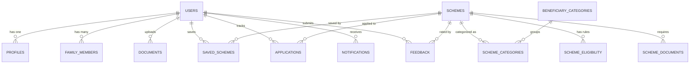

# 🇮🇳 Database Documentation — NO POVERTY Welfare Platform

## Overview
The **NO POVERTY** database (`no_poverty_db`) is designed for **MySQL 8.0+** and is fully compatible with **MySQL Workbench**, **phpMyAdmin**, or command-line MySQL client.

It models citizens, beneficiary categories, welfare schemes, eligibility rules, required documents, saved schemes, internal application tracking, notifications, search & view history, and citizen feedback.

---

## Database Connection Details (Default)

| Parameter | Value |
|---|---|
| Host | `localhost` |
| Port | `3306` |
| Database Name | `no_poverty_db` |
| Username | `root` (or configured user) |
| Password | `root` (or configured password) |
| Character Set | `utf8mb4` |
| Collation | `utf8mb4_unicode_ci` |

---

## How to Initialize Database in MySQL Workbench

1. Open **MySQL Workbench**.
2. Connect to your local MySQL 8 Server instance.
3. Open SQL Query tab:
   - Go to **File -> Open SQL Script...**
   - Select `database/schema.sql` and click **Execute** (⚡ icon) to create tables and indexes.
4. Populate initial data:
   - Go to **File -> Open SQL Script...**
   - Select `database/sample_data.sql` and click **Execute** (⚡ icon).
5. Verify:
   ```sql
   USE no_poverty_db;
   SHOW TABLES;
   SELECT COUNT(*) FROM schemes;
   ```

---

## How to Initialize via Command Line

```bash
# Login to MySQL
mysql -u root -p

# Run schema and sample data
source database/schema.sql;
source database/sample_data.sql;
```

---

## Entity Relationship Overview



---

## Pre-Configured Test Accounts

| Role | Email | Password | Purpose |
|---|---|---|---|
| **Citizen (Farmer/Rural)** | `citizen@example.com` | `password123` | Testing farmer profile, PM-KISAN, PMAY-G |
| **Citizen (Student/Youth)** | `pooja.student@example.com` | `password123` | Testing student profile, NSP Scholarship |
| **Administrator** | `admin@nopoverty.gov.in` | `admin123` | Admin dashboard, scheme CRUD, categories |
| **Developer Admin** | `dev@nopoverty.gov.in` | `devadmin123` | Analytics, system logs, developer mode |

